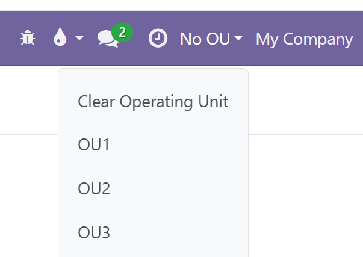

This module adds an Operating Unit selector in the top navigation bar,
to the left of the company switcher. Click it to open a dropdown
listing all operating units you have been granted access to.

Select an operating unit to activate it. Use **Clear Operating Unit** to
work without a specific operating unit.  
Each browser tab maintains its own active operating unit, allowing you
to work with different operating units simultaneously across tabs.  
The selected operating unit is maintained when you reload or duplicate your browser tab.